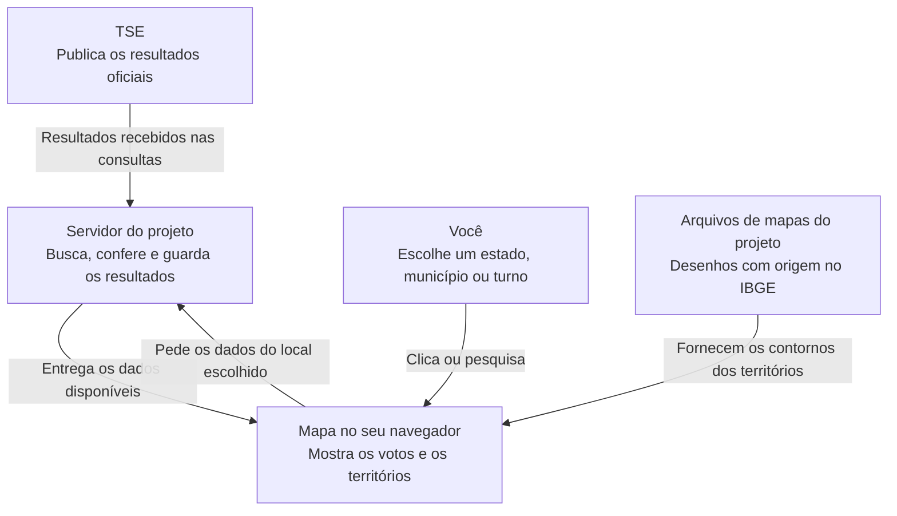
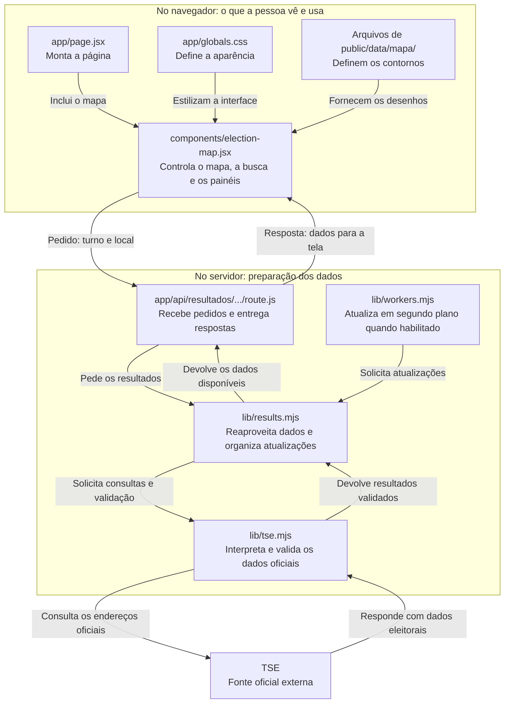
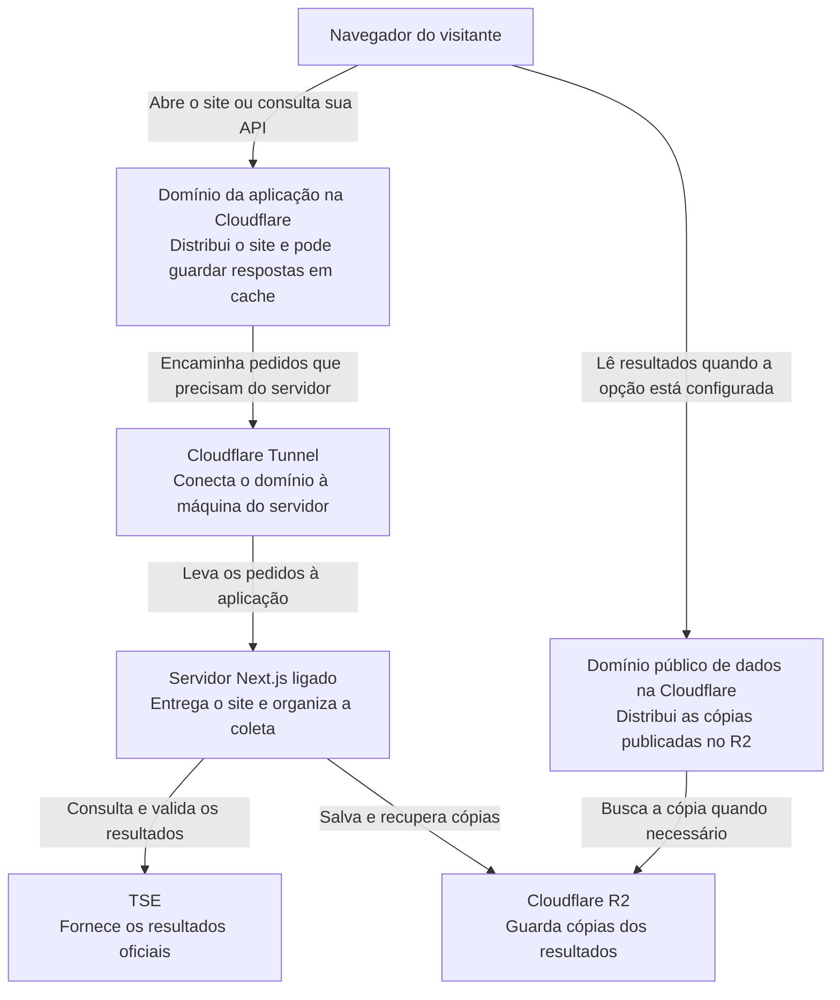

# Presidenciáveis — guia para iniciantes

Este projeto é um site para acompanhar a contagem de votos para a Presidência do Brasil em um mapa interativo. Você pode consultar o Brasil, os estados e os municípios.

Este guia foi escrito para quem está começando a programar ou quer entender o projeto sem conhecer os termos técnicos. A documentação detalhada está no [README principal](README.md).

## O que o site faz?

O mapa permite:

- Alternar entre o primeiro e o segundo turno, quando os dados estiverem disponíveis.
- Abrir um estado e consultar seus municípios.
- Pesquisar uma localidade.
- Consultar votos, percentuais e o andamento da apuração.
- Ver informações como votos brancos, nulos e abstenção, conforme os dados disponíveis.

**Apuração** é o processo de contar os votos. **Abstenção** representa quem não compareceu para votar.

O site apresenta informações obtidas do Tribunal Superior Eleitoral, o **TSE**. Os desenhos dos mapas têm origem no Instituto Brasileiro de Geografia e Estatística, o **IBGE**, e já estão incluídos no projeto.

## Preciso saber programar para usar?

Para consultar o mapa em um site já publicado, basta abrir o endereço no navegador.

Para executar sua própria cópia no computador, você precisará instalar uma ferramenta e digitar alguns comandos. As próximas seções explicam esse caminho. Executar uma cópia no computador não publica o site na internet.

## Como tudo funciona?

Imagine um painel de avisos que recebe atualizações:

1. O servidor do projeto consulta os resultados oficiais do TSE.
2. Ele verifica se a resposta corresponde à eleição e ao local solicitados.
3. Guarda os resultados para reaproveitá-los nas próximas consultas.
4. O navegador recebe esses dados e atualiza o mapa e os números.

O **servidor** é o programa que prepara e entrega as informações. O **navegador** é o aplicativo em que você abre o site, como Chrome, Firefox ou Safari. Ao seguir este guia, seu computador executará o servidor e também poderá abrir o mapa no navegador.

Guardar uma cópia temporária dos dados é chamado de **cache**. Isso evita que cada visitante provoque uma consulta separada ao TSE.

Se uma atualização falhar, o projeto preserva o último resultado válido que tiver recebido. Uma falha não é tratada como zero votos. Se ainda não houver dados válidos, pode não haver resultado para mostrar.

**A atualização não é instantânea:** o mapa consulta novas informações em intervalos, e alguns locais podem levar mais tempo para atualizar. A cópia atual do código está preparada para o ciclo eleitoral de 2026; usar outro ano exige alterações no código.

## A arquitetura em desenhos

**Arquitetura** é a organização das partes do sistema e a forma como elas se comunicam. Os desenhos abaixo mostram o mesmo projeto com diferentes níveis de detalhe. Cada seta tem uma descrição do que acontece naquele caminho.

### Para qualquer pessoa: de onde vêm os números?



**Exemplo:** você escolhe São Paulo. O mapa pede ao servidor os resultados desse estado e de seus municípios. O servidor entrega os dados que já tem e organiza as atualizações necessárias. O navegador combina esses números com os desenhos dos territórios para exibir o mapa.

Os números e os desenhos têm origens diferentes: o TSE fornece os resultados, enquanto os contornos já estão nos arquivos do projeto. O navegador recebe os dados eleitorais pelo sistema do projeto; as consultas ao TSE ficam no servidor.

### Para quem está aprendendo a programar: qual arquivo faz o quê?

Neste desenho, **pedido** é uma solicitação de dados e **resposta** é o conteúdo devolvido. As setas de resposta mostram o caminho dos resultados até a tela.



O desenho destaca o caminho dos resultados. O Next.js também prepara e entrega a página e os arquivos ao navegador. O CSS e os arquivos de mapa aparecem no desenho como recursos utilizados pela interface.

Pense na **API** como um balcão de atendimento: ela recebe o pedido do mapa e usa o serviço de resultados para responder. `lib/results.mjs` organiza o trabalho; `lib/tse.mjs` cuida das particularidades dos dados do TSE. Os mini workers permitem iniciar atualizações mesmo sem um visitante fazendo um pedido, quando estão habilitados e o servidor continua rodando.

### Para quem quer publicar: onde entra a Cloudflare?

Esta é uma configuração opcional de publicação. **Domínio** é o endereço do site. O domínio da aplicação abre o mapa; o domínio de dados permite ler cópias dos resultados guardadas no R2.



Neste último desenho, as setas representam pedidos e acesso aos serviços; as respostas voltam pelo mesmo caminho. Com a leitura pública habilitada, o navegador pode receber resultados pelo domínio de dados. Se essa cópia falhar, estiver incompatível ou tiver uma publicação com três minutos ou mais, ele tenta a API da aplicação.

O R2 guarda dados, e o Tunnel conecta a aplicação à internet. O programa Next.js continua precisando de uma máquina ou serviço de hospedagem em execução. Para experimentar no seu computador, o caminho básico do primeiro desenho já é suficiente.

## Pequeno dicionário do projeto

| Termo | Explicação simples |
| --- | --- |
| Código-fonte | Arquivos com as instruções que fazem o site funcionar. |
| Repositório | Pasta do projeto acompanhada de seu histórico de alterações. |
| Terminal | Janela em que você digita comandos para o computador executar. |
| JavaScript | Linguagem usada para escrever a lógica deste projeto. |
| CSS | Regras que definem cores, tamanhos, espaçamentos e a aparência do site. |
| Node.js | Ferramenta que permite executar JavaScript fora do navegador, inclusive o servidor. |
| npm | Ferramenta instalada com o Node.js que baixa os pacotes e executa os comandos do projeto. |
| Dependências | Pacotes de código prontos que o projeto utiliza. |
| React | Biblioteca que ajuda a construir e atualizar a interface que aparece na tela. |
| Next.js | Estrutura que organiza o site e seu servidor, usando React. |
| API | Um caminho pelo qual programas pedem e recebem informações. Aqui, o mapa pede resultados ao servidor do projeto. |
| JSON | Formato de texto usado para organizar e trocar dados. |
| UF | Sigla de uma unidade da federação, como SP, BA ou DF. |

Você não precisa decorar esses nomes para começar.

## Como executar no seu computador

### 1. Prepare as ferramentas

Você precisará de:

- A pasta completa do projeto no computador.
- **Node.js na versão 22.13 ou superior**, com o npm.
- Um navegador e acesso à internet para consultar os resultados.
- Um editor de texto para explorar o código, se quiser. O Visual Studio Code é um exemplo.

Depois de instalar o Node.js, abra o terminal. No Windows, você pode usar o PowerShell; no macOS, o aplicativo Terminal; no Linux, o terminal da sua distribuição.

Digite um comando de cada vez e pressione Enter:

```sh
node --version
npm --version
```

Se aparecerem os números das versões, as ferramentas estão disponíveis. A versão do Node.js deve atender ao requisito acima. Se o comando não for reconhecido, feche e abra o terminal após a instalação e tente novamente.

### 2. Abra o terminal na pasta certa

Use a pasta que contém o arquivo [package.json](package.json). Esse arquivo lista os pacotes e comandos do projeto.

Se estiver usando o Visual Studio Code, abra a pasta do projeto e escolha **Terminal → Novo Terminal**.

Você também pode navegar pelo terminal com `cd`, que significa mudar de pasta:

```sh
cd "caminho/para/a/pasta/corridadaapuracao"
```

Substitua o caminho entre aspas pela localização real da pasta no seu computador. As aspas permitem usar caminhos que contêm espaços.

### 3. Instale as dependências

Na pasta do projeto, execute:

```sh
npm ci
```

Esse comando baixa as dependências nas versões registradas pelo projeto. Aguarde até o terminal terminar e permitir digitar novamente. A instalação precisa de internet e pode levar alguns minutos.

### 4. Entenda as configurações opcionais

Para experimentar o mapa localmente, você pode começar sem criar um arquivo de configuração e sem contratar serviços da Cloudflare.

O arquivo [.env.example](.env.example) é um modelo de configurações. Se precisar personalizar o funcionamento, faça uma cópia dele na mesma pasta e dê à cópia o nome `.env.local`. Use um editor de texto para alterar os valores.

Um arquivo `.env.local` guarda **variáveis de ambiente**: opções que o servidor lê para saber como deve funcionar. Ele pode conter senhas e chaves de acesso; não publique esse arquivo nem o envie para o repositório.

Para os primeiros passos, deixe as opções de R2 e a URL pública de resultados sem preenchimento. O projeto consegue trabalhar com resultados guardados na memória do servidor.

### 5. Ligue o site

Execute:

```sh
npm run dev
```

Esse comando inicia o modo de desenvolvimento, usado para estudar e modificar o projeto. O terminal fica ocupado enquanto o servidor está funcionando; isso é esperado.

Abra no navegador:

[http://localhost:3000](http://localhost:3000)

`localhost` significa o seu próprio computador. `3000` é a porta, um número que identifica por onde acessar esse servidor. Se o terminal informar outro endereço ou porta, use o endereço indicado nele.

O mapa faz consultas reais ao TSE quando você acessa os resultados. A primeira leitura pode demorar, e um turno ainda não configurado pelo TSE pode estar indisponível. Abrir o site não garante que já existam resultados publicados para todos os locais.

### 6. Desligue quando terminar

Volte ao terminal em que o site está rodando e pressione **Ctrl + C**. Para ligar novamente, execute `npm run dev` na pasta do projeto.

## Onde está cada parte do projeto?

| Arquivo ou pasta | Para que serve |
| --- | --- |
| [app/page.jsx](app/page.jsx) | Monta a página inicial. |
| [components/election-map.jsx](components/election-map.jsx) | Controla o mapa, a busca e a interação com os resultados. |
| [app/globals.css](app/globals.css) | Define a aparência e a adaptação a telas de tamanhos diferentes. |
| [app/api/](app/api/) | Contém os caminhos usados para entregar dados ao navegador. |
| [lib/](lib/) | Reúne a lógica do servidor: consultas, verificações e armazenamento de resultados. |
| [public/data/mapa/](public/data/mapa/) | Guarda os arquivos com os desenhos dos territórios. |
| [test/](test/) | Contém verificações automáticas do funcionamento do projeto. |
| [docs/](docs/) | Reúne explicações adicionais. |
| [package.json](package.json) | Lista dependências e comandos disponíveis. |

## Por onde começar a estudar?

Um caminho possível é:

1. Execute o site e explore o mapa para conhecer seu funcionamento.
2. Abra `app/page.jsx` para ver como a página é montada.
3. Explore `app/globals.css` e experimente alterar uma cor ou um espaçamento.
4. Salve e observe a mudança no navegador com o modo de desenvolvimento ligado.
5. Depois, leia `components/election-map.jsx` para conhecer as interações.
6. Quando estiver mais confortável, explore `lib/tse.mjs` e `lib/results.mjs` para entender como os dados chegam.

Faça mudanças pequenas, uma de cada vez. Assim fica mais fácil entender qual alteração produziu cada efeito.

Toda interpretação e validação dos dados do TSE deve continuar em `lib/`, no servidor. O navegador recebe resultados pela API do projeto ou pela cópia pública configurada para ele.

## Como verificar se o projeto continua funcionando?

Para executar os testes automáticos:

```sh
npm test
```

Os testes usam respostas locais e armazenamento simulado. Eles não precisam multiplicar consultas ao TSE.

Para preparar a versão de produção:

```sh
npm run build
```

**Build** é a preparação dos arquivos para executar o site em produção. Se terminar com sucesso, você pode iniciar essa versão com:

```sh
npm start
```

Pare o servidor de desenvolvimento antes se ele estiver usando a mesma porta. Esses comandos preparam e executam o site; a publicação na internet exige configurar onde ele ficará hospedado.

## E a Cloudflare mencionada no README principal?

Ela participa de uma configuração opcional de armazenamento e distribuição:

| Recurso | Explicação simples |
| --- | --- |
| Cloudflare R2 | Guarda cópias dos resultados fora da memória do servidor, para reaproveitá-las inclusive após reinícios. |
| Cache da Cloudflare | Guarda cópias de respostas para atender visitantes com menos trabalho no servidor. |
| Cloudflare Tunnel | Conecta um endereço público ao servidor que está rodando em uma máquina. Essa máquina precisa continuar ligada e conectada. |
| Mini workers do projeto | Tarefas do próprio servidor que atualizam resultados em segundo plano. Não são um serviço separado da Cloudflare. |

Você pode aprender a executar o projeto antes de configurar esses recursos. Quando quiser publicá-lo, consulte as seções de [R2](README.md#cloudflare-r2), [cache](README.md#cache-na-cloudflare) e [Tunnel e domínio](README.md#cloudflare-tunnel-e-domínio-próprio) no guia técnico.

## Problemas comuns

| O que aconteceu? | O que verificar |
| --- | --- |
| `node` ou `npm` não foi reconhecido | Confirme a instalação do Node.js e abra um novo terminal. |
| O terminal diz que não encontrou `package.json` | Confira se você abriu o terminal na pasta do projeto. |
| A instalação dos pacotes falhou | Confira sua conexão e a versão do Node.js. Leia a mensagem exibida no terminal. |
| O navegador não abre o site local | Confirme se `npm run dev` continua rodando e use o endereço informado no terminal. |
| A porta 3000 está ocupada | Use a porta alternativa indicada pelo servidor ou encerre o outro servidor que você iniciou. |
| O mapa abre, mas faltam resultados | Aguarde a coleta e confira se o turno já está disponível no TSE. Dados ausentes não significam zero votos. |
| Uma alteração nas configurações não apareceu | Pare e reinicie o servidor. Algumas opções públicas também exigem um novo build de produção. |

Para entender detalhes de funcionamento, configuração e manutenção, continue pelo [README técnico](README.md). Para conhecer a origem dos desenhos do mapa, consulte [malhas do mapa](docs/malhas.md).
