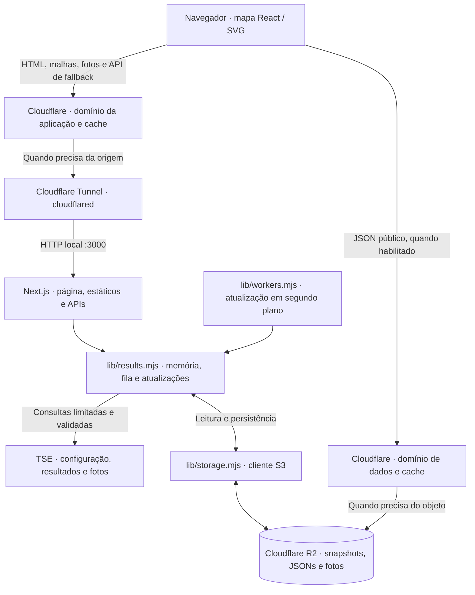
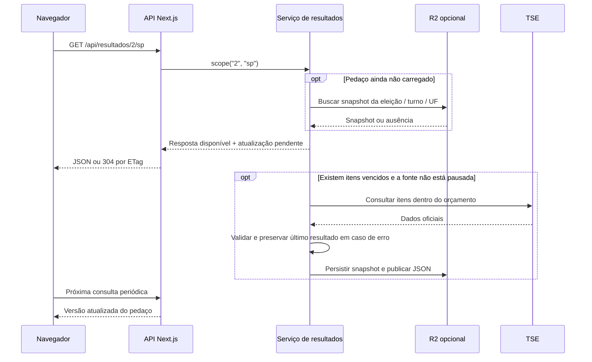

<p align="center">
  
</p>

<h1 align="center">Corrida da Apuração · Presidenciáveis</h1>

<p align="center">
  Apuração presidencial do Brasil, dos estados e dos municípios em um mapa interativo.<br />
  Dados oficiais do TSE, malhas locais do IBGE e distribuição pela Cloudflare.
</p>

<p align="center">
  <a href="#arquitetura">Arquitetura</a> ·
  <a href="#executar-localmente">Instalação</a> ·
  <a href="#cloudflare-r2">R2</a> ·
  <a href="#cache-na-cloudflare">Cache</a> ·
  <a href="#cloudflare-tunnel-e-domínio-próprio">Tunnel e domínio</a>
</p>

## Visão geral

Aplicação Next.js com App Router, uma página de navegação e duas rotas de API: resultados e fotos das candidaturas. O mapa permite alternar turnos, abrir uma UF, selecionar territórios, pesquisar localidades e consultar votos, percentuais, seções apuradas, brancos, nulos e abstenção conforme os dados disponíveis.

O princípio da arquitetura é compartilhar o trabalho de coleta: visitantes consultam cópias dos resultados, enquanto o servidor organiza as leituras do TSE, valida respostas e preserva o último resultado válido. Uma visita não precisa iniciar uma coleta independente.

| Tecnologia | Função |
| --- | --- |
| Node.js ≥ 22.13 | Executa o servidor e a atualização em segundo plano |
| Next.js 16.4.3 | Serve a página, os estáticos e as APIs |
| React 19.3.1 | Controla o mapa SVG, a navegação e os painéis |
| TSE | Fonte de configuração eleitoral, resultados e fotos |
| IBGE | Origem das malhas já incluídas no repositório |
| AWS SDK para S3 | Acessa o R2 pela interface compatível com S3 |
| Cloudflare R2, opcional | Persiste resultados e publica uma cópia para leitura direta |
| Cloudflare Cache e Tunnel | Distribuem respostas e conectam o domínio ao servidor |

As versões declaradas estão em [package.json](package.json); o lockfile fixa a resolução das dependências. O código usa JavaScript e CSS, sem TypeScript, banco relacional ou Redis.

> Este documento descreve a implementação do repositório. Os exemplos de infraestrutura precisam ser aplicados na sua conta; sua presença aqui não significa que bucket, DNS, regras ou Tunnel já estejam configurados.

## Sumário

- [Arquitetura](#arquitetura)
- [Organização do código](#organização-do-código)
- [Ciclo dos resultados](#ciclo-dos-resultados)
- [API e contrato de dados](#api-e-contrato-de-dados)
- [Workers e proteção da fonte](#workers-e-proteção-da-fonte)
- [Camadas de cache](#camadas-de-cache)
- [Executar localmente](#executar-localmente)
- [Variáveis de ambiente](#variáveis-de-ambiente)
- [Cloudflare R2](#cloudflare-r2)
- [Cache na Cloudflare](#cache-na-cloudflare)
- [Cloudflare Tunnel e domínio próprio](#cloudflare-tunnel-e-domínio-próprio)
- [Operação e diagnóstico](#operação-e-diagnóstico)
- [Testes e manutenção](#testes-e-manutenção)

## Arquitetura



Há dois caminhos de leitura dos votos:

1. **Pela aplicação:** navegador → Cloudflare → Tunnel → `/api/resultados/...` → cache do servidor.
2. **Pelo R2:** navegador → domínio público de dados → JSON publicado no bucket. Se a cópia falhar, estiver incompatível ou tiver uma publicação com 3 minutos ou mais, o navegador tenta a API da aplicação.

O segundo caminho é ativado por `NEXT_PUBLIC_RESULTS_URL`. HTML, malhas e fotos continuam usando o domínio da aplicação. O layout também mantém um preload de `/api/resultados/2/br`, mesmo com leitura pública habilitada.

O **Tunnel** transporta requisições até a máquina que executa o Next.js. O **R2** armazena objetos. O **cache da Cloudflare** reutiliza respostas na borda. Os **mini workers** são loops dentro do processo Node.js: não são Cloudflare Workers.

## Organização do código

```text
app/
├── layout.jsx                         Metadados, estilos, preloads e analytics
├── page.jsx                           Página inicial e montagem do mapa
├── globals.css                        Aparência e responsividade
└── api/
    ├── resultados/[turno]/[uf]/route.js Resultados, ETag, gzip e cache HTTP
    └── fotos/[turno]/[id]/route.js      Fotos com cache e validação
components/
└── election-map.jsx                   Mapa SVG, interação, busca e polling
lib/
├── tse.mjs                            Adaptador e validação dos dados oficiais
├── results.mjs                        Coleta, cache, snapshots e resposta compacta
├── instance.mjs                       Instância compartilhada por processo
├── storage.mjs                        Leitura e escrita no R2 via S3
├── workers.mjs                        Agendamento de atualizações em fatias
└── party-colors.mjs                    Paleta dos partidos
public/
├── data/mapa/                         Geometrias JSON e suas versões gzip
├── logo.webp                          Marca usada atualmente na interface
└── ...                                Ícones e imagens de compartilhamento
docs/
├── malhas.md                          Origem, formato e compressão das malhas
├── IDEIA.md                           Contexto original do projeto
└── og-image-prompt.md                  Referência para imagem de compartilhamento
test/
└── results.test.mjs                    Testes locais do adaptador e serviço
instrumentation.js                     Inicialização dos workers no runtime Node.js
next.config.mjs                        Configuração e cabeçalhos das malhas
.env.example                           Referência de configuração
image.png                              Logo apresentada neste README
```

### Interface e geometrias

[ElectionMap](components/election-map.jsx) carrega a malha nacional e depois a malha da UF solicitada. Os arquivos contêm caminhos SVG prontos; nenhuma biblioteca de mapas ou consulta ao IBGE é necessária durante a navegação.

O navegador tenta `.json.gz`, descompacta com `DecompressionStream` e usa `.json` como alternativa. Downloads em andamento e geometrias carregadas ficam em memória. Passar o mouse ou focar uma UF antecipa seu carregamento, respeitando as verificações de conexão do componente.

A seleção é refletida no fragmento da URL, permitindo compartilhar localização e turno. As cores indicam liderança e margem de votos; empate e ausência de votos têm tratamentos próprios. A malha incluída contém 5.570 territórios e não pretende afirmar a divisão municipal mais recente; a correspondência eleitoral efetiva vem da configuração do TSE. Veja [dados geográficos](docs/malhas.md), inclusive o tratamento do Distrito Federal.

### Adaptador do TSE

[lib/tse.mjs](lib/tse.mjs) concentra URLs, identificação da eleição, correspondência IBGE → TSE, normalização e validação. O ciclo está definido como `ele2026`; mudar o ano exige revisar o adaptador e seus testes.

O código busca a configuração oficial em `https://resultados.tse.jus.br/oficial/comum/config/ele-c.json` e seleciona o cargo de Presidente, código `1`, para o turno solicitado. Os códigos da eleição são descobertos nessa configuração.

Cada resultado é conferido quanto a eleição, turno, ambiente oficial, território e cargo. Votos inválidos e percentuais de seções fora do intervalo aceito são recusados. O horário de geração do TSE é preservado como texto, sem inventar um fuso horário. Toda consulta eleitoral ao TSE acontece no servidor.

## Ciclo dos resultados

Um **pedaço de resultados**, chamado de *chunk* no código, reúne uma abrangência por turno:

| Chave lógica | Conteúdo |
| --- | --- |
| `2:br` | Resumo do Brasil e resultados das 27 UFs no segundo turno |
| `2:sp` | Resumo de SP e resultados municipais disponíveis para SP |
| `1:mg` | Resumo de MG e resultados municipais disponíveis para MG no primeiro turno |



O diagrama simplifica a descoberta inicial da eleição: em um processo novo, configuração do TSE e leitura do R2 podem precisar terminar antes da primeira resposta. O servidor evita esperar uma varredura completa dos municípios, mas o primeiro acesso não é necessariamente instantâneo.

1. A API valida turno e UF e encontra a eleição correspondente.
2. O serviço reutiliza o pedaço em memória ou tenta restaurar seu snapshot do R2.
3. Entrega o conteúdo disponível e inicia uma atualização compartilhada dos itens vencidos. Uma única atualização por pedaço pode estar ativa no processo.
4. Cada leitura válida substitui seu item. Em caso de falha, os votos anteriores permanecem acompanhados de um indicador de erro.
5. Pedaços alterados são persistidos ao longo do trabalho. Cada persistência também escreve o JSON público.
6. A interface repete a leitura da abrangência aberta: normalmente a cada 10 s, a cada 3 s enquanto `filling` estiver ativo e após 30 s em caso de erro, sempre com até 1 s adicional aleatório. O polling pausa em abas ocultas.

O cliente verifica o contrato recebido e reconstrói os candidatos a partir do cadastro compartilhado na resposta. Erros ou leituras antigas podem exibir a indicação de últimos dados disponíveis.

## API e contrato de dados

| Método e rota | Resposta |
| --- | --- |
| `GET /api/resultados/2/br` | Resumo nacional e itens das UFs |
| `GET /api/resultados/2/sp` | Resumo estadual e itens municipais |
| `GET /api/resultados/1/mg` | Mesmo contrato, para o primeiro turno |
| `GET /api/fotos/2/<id>` | Foto de candidatura identificada nos dados carregados ou já persistida |

`turno` aceita `1` ou `2`. A API normaliza a UF para minúsculas e aceita `br` ou uma das 27 siglas. Resultados usam `schemaVersion: 2`.

| Campo | Significado |
| --- | --- |
| `election`, `date`, `round`, `uf` | Identificação da eleição e abrangência |
| `updatedAt` | Última coleta bem-sucedida no pedaço, em milissegundos Unix; pode ser `null` |
| `filling` | Preenchimento inicial em andamento; não sinaliza toda atualização |
| `pausedUntil` | Fim da pausa global da fonte no processo, ou `null` |
| `summary` | Entrada de resultado da própria abrangência |
| `items` | Entradas das UFs ou dos municípios, conforme o pedaço |
| `candidates` | Cadastro por ID com nome, partido, número e cor |
| `publishedAt` | Momento da publicação; acrescentado apenas no JSON público do R2 |

Cada entrada pode conter `checkedAt`, `error` e `result`. Uma entrada sem leitura válida pode não ter `result`; isso não equivale a zero votos. Quando presente, o resultado inclui liderança, total dos candidatos válidos, seções apuradas, conclusão, geração, candidatos, brancos, nulos e abstenção.

O resumo inclui até 12 candidatos; cada item territorial inclui até os dois primeiros. Nomes e partidos aparecem uma vez no cadastro compartilhado. Os percentuais dos candidatos são calculados sobre o total de votos dos candidatos válidos aceitos pelo adaptador; percentuais de brancos, nulos e abstenção vêm dos campos do TSE, com suas bases próprias.

As respostas de resultados usam ETag fraco, `Vary: Accept-Encoding` e gzip quando aceito. Um `If-None-Match` correspondente recebe `304`, sem corpo. Seleção inválida retorna `400`; turno não configurado, `404`; indisponibilidade sem resposta utilizável pode retornar `503`. Erros HTTP dessas rotas usam `Cache-Control: no-store`.

Fotos passam pelo mesmo orçamento de requisições ao TSE. O servidor verifica formato e tamanho, reutiliza memória e R2 e evita buscar IDs arbitrários ainda desconhecidos. A interface apresenta uma alternativa quando a foto não carrega.

## Workers e proteção da fonte

[instrumentation.js](instrumentation.js) inicia os loops de [lib/workers.mjs](lib/workers.mjs) no runtime Node.js. Eles compartilham com as rotas a instância de [lib/instance.mjs](lib/instance.mjs).

Por padrão, são 4 loops, cada um atendendo fatias de até 40 itens. A prioridade é Brasil, depois pedaços vistos nos últimos 5 minutos e, por fim, rodízio entre os demais, favorecendo o atendido há mais tempo. O turno padrão dos workers é o mais recente configurado pelo TSE, que pode ser diferente do turno inicialmente selecionado na interface, o segundo.

### Frequências de leitura

| Tipo de dado | Intervalo padrão |
| --- | --- |
| Configuração de eleições | 5 min em memória |
| Correspondência municipal | 6 h em memória; também reaproveitada do R2 |
| Brasil e UFs em apuração | 30 s |
| Municípios em apuração | 3 min |
| Resultado com apuração completa | Pelo menos 10 min |
| Fotos | 24 h em memória |

São intervalos mínimos de elegibilidade para uma nova leitura. Fila, latência da fonte, pausas, número de turnos e quantidade de itens podem aumentar o tempo efetivo. Não há garantia de atualização de todas as cidades nesse intervalo.

### Limites e recuperação

- Consultas ao TSE iniciadas pelo serviço passam por um espaçamento global por processo, padrão de 40 requisições/s.
- `TSE_CONCURRENCY=8` limita o paralelismo da varredura sob demanda; cada fatia dos workers usa concorrência `2`. Essa configuração não é um semáforo global para todas as varreduras simultâneas.
- Respostas `403` ou `429` pausam novas consultas por pelo menos 10 minutos. Um `Retry-After` numérico maior pode ampliar a pausa.
- Três falhas consecutivas interrompem a varredura daquele pedaço, com espera de 1 minuto antes de nova tentativa do pedaço. Itens com erro também têm recuo individual progressivo.
- O último resultado válido é mantido. Falhas de rede, validação ou persistência não geram votação artificialmente zerada.

Os workers exigem um processo contínuo. Em serverless, a atualização sob demanda usa `after()` e depende da duração permitida pela plataforma; não há garantia de varreduras longas nem de loops permanentes.

**Para esta implementação, prefira uma instância de coleta.** R2 permite reaproveitar snapshots e o serviço tenta mesclar leituras mais recentes antes de atualizar, mas não fornece eleição de líder, lock distribuído, escrita atômica entre os dois objetos nem orçamento global entre processos. Desligar workers nas réplicas reduz duplicação; as APIs dessas réplicas ainda podem iniciar coletas sob demanda.

## Camadas de cache

| Camada | Conteúdo e comportamento |
| --- | --- |
| Navegador, memória | Malhas, resultados abertos e promessas de requisições em andamento |
| Cache HTTP do navegador | Revalidação de resultados da API por ETag; cópia pública com `max-age=5` |
| Memória do Node.js | Itens coletados, configuração, fotos e resposta JSON/gzip pronta por versão |
| Snapshot R2 | Estado recuperável da coleta, independente de visitas e reinícios |
| JSON público R2 | Representação compacta para o navegador, com `publishedAt` |
| Borda Cloudflare | Cópias HTTP compartilhadas, conforme regras da zona e cabeçalhos |

JSON e gzip do servidor são reaproveitados até a versão mudar. Durante mudanças rápidas, a montagem ocorre no máximo uma vez por segundo por pedaço, salvo mudanças dos indicadores de preenchimento ou pausa.

### Cabeçalhos emitidos pelo código

| Recurso | `Cache-Control` |
| --- | --- |
| API de resultados | `public, max-age=0, s-maxage=5, stale-while-revalidate=30` |
| JSON público no R2 | `public, max-age=5` |
| Snapshots e configuração JSON no R2 | `no-cache` |
| Fotos pela API | `public, max-age=86400, stale-while-revalidate=604800` |
| Fotos gravadas no R2 | `public, max-age=86400` |
| Malhas em `/data/mapa/` | `public, max-age=86400, stale-while-revalidate=604800` |

**Atenção à combinação da API:** a documentação atual da Cloudflare informa que `s-maxage` pode desativar `stale-while-revalidate` pela semântica de revalidação obrigatória. O código envia ambos; por isso, este README não promete 30 s de resposta antiga na borda. A configuração abaixo preserva os cabeçalhos atuais. Um comportamento diferente exige revisar cabeçalhos e regras juntos. Veja [Origin Cache Control](https://developers.cloudflare.com/cache/concepts/cache-control/).

Há três relógios diferentes: `checkedAt` é a verificação de um item, `updatedAt` registra uma coleta bem-sucedida no pedaço e `publishedAt` registra a publicação do objeto. Uma publicação recente pode conter itens antigos preservados após falhas. O limite de 3 min do fallback verifica a publicação, não a atualidade de cada município. A interface usa 4 min como referência de leitura antiga; resultados completos, consultados com intervalo maior, também podem receber esse aviso.

## Executar localmente

Requisitos: Node.js ≥ 22.13, npm e acesso à internet para consultar o TSE. R2 e Cloudflare são opcionais no desenvolvimento.

```sh
npm ci
cp .env.example .env.local
npm run dev
```

Abra `http://localhost:3000`. `npm ci` instala conforme o lockfile; use `npm install` ao atualizar dependências. O desenvolvimento faz consultas reais quando a API é acessada. Os testes usam respostas locais.

### Produção

Preencha `.env.local` antes do build, especialmente `NEXT_PUBLIC_RESULTS_URL` quando usada:

```sh
npm run build
npm start -- --hostname 127.0.0.1 --port 3000
```

O bind em `127.0.0.1` é adequado quando `cloudflared` executa na mesma máquina. Containers separados precisam de endereço acessível entre eles.

> No arquivo de exemplo, `BACKGROUND_WORKERS=` está vazio. O código só aplica o padrão de produção quando a variável está ausente; uma variável presente e vazia mantém os workers desligados. Na instância de coleta, defina explicitamente `BACKGROUND_WORKERS=true`.

## Variáveis de ambiente

Use [.env.example](.env.example) como ponto de partida. As faixas abaixo vêm da validação implementada. Configurações inválidas podem impedir a inicialização do serviço.

### Fonte e atualização

| Variável | Padrão do código | Faixa ou finalidade |
| --- | --- | --- |
| `TSE_RPS` | `40` | Inteiro de 1 a 50; limite de início de requisições por segundo por processo |
| `TSE_CONCURRENCY` | `8` | Inteiro de 1 a 16; concorrência de uma varredura sob demanda |
| `TSE_TIMEOUT_MS` | `8000` | De 100 a 60000 ms |
| `REGIONAL_INTERVAL_MS` | `30000` | De 1000 a 86400000 ms |
| `MUNICIPAL_INTERVAL_MS` | `180000` | De 1000 a 86400000 ms |
| `COMPLETE_INTERVAL_MS` | `600000` | De 1000 a 86400000 ms; combinado com o intervalo do tipo de território |

### Workers

| Variável | Padrão do código | Finalidade |
| --- | --- | --- |
| `BACKGROUND_WORKERS` | `true` em produção, `false` fora dela, se ausente | Apenas o texto `true` habilita os loops |
| `WORKERS` | `4` | Inteiro de 1 a 16 |
| `WORKER_SLICE` | `40` | De 1 a 1000 itens por fatia |
| `WORKER_ROUNDS` | `latest` | Turno mais recente configurado; também aceita `1`, `2` ou `1,2` |

### R2 e distribuição pública

| Variável | Padrão | Finalidade |
| --- | --- | --- |
| `R2_ACCOUNT_ID` | Sem valor | ID da conta Cloudflare |
| `R2_ACCESS_KEY_ID` | Sem valor | Access Key ID para a API S3 do R2 |
| `R2_SECRET_ACCESS_KEY` | Sem valor | Secret Access Key, somente no servidor |
| `R2_BUCKET` | `eleicao` | Nome do bucket |
| `R2_PREFIX` | `presidente` | Prefixo das chaves dos objetos |
| `R2_PERSIST_INTERVAL_MS` | `10000` | De 1000 a 600000 ms; persistência de pedaços alterados |
| `NEXT_PUBLIC_RESULTS_URL` | Sem valor | URL pública completa até `/<prefixo>/publico` |

Sem o conjunto das três variáveis de autenticação, `createStorage()` retorna `null` e o serviço funciona apenas com memória. Credenciais incorretas não significam armazenamento operacional: falhas de leitura são toleradas e falhas de escrita deixam o pedaço marcado para nova tentativa.

`NEXT_PUBLIC_RESULTS_URL` é pública e incorporada ao JavaScript no **build**. Alterá-la exige novo build. Credenciais R2 não devem receber o prefixo `NEXT_PUBLIC_`. Mudanças nas variáveis do servidor exigem reiniciar o processo.

## Cloudflare R2

### Persistência e estrutura dos objetos

Com os valores padrão, o bucket recebe:

```text
eleicao/
└── presidente/
    ├── <codigo-eleicao>/
    │   └── 2/
    │       ├── br.json              Snapshot interno, schemaVersion 1
    │       └── sp.json              Estado da coleta da UF e municípios
    ├── config/
    │   └── municipios-<codigo-eleicao>.json
    ├── fotos/
    │   └── <codigo-eleicao>/
    │       └── <id-candidatura>.jpeg
    └── publico/
        └── 2/
            ├── br.json              Resposta pública, schemaVersion 2
            └── sp.json              Resposta pública, schemaVersion 2
```

`eleicao` é o bucket; seu nome não faz parte da chave do objeto. `<codigo-eleicao>` é descoberto no TSE. O turno `1` segue a mesma organização.

O snapshot inclui estado de coleta e erros para recuperação. O JSON público usa o contrato compacto da API e acrescenta `publishedAt`. Ambos são gravados na mesma operação lógica de persistência, com duas escritas independentes. Não há transação entre elas nem histórico de versões implementado pela aplicação.

O intervalo de persistência é uma cadência de trabalho, não um cron que reescreve todos os arquivos. Pedaços sem alteração não são republicados. Um JSON com apuração completa pode ultrapassar 3 min de publicação antes da próxima consulta programada e levar o cliente à API.

### Criar e conectar o bucket

1. Crie um bucket, por exemplo `eleicao`.
2. Gere credenciais R2 com permissão **Object Read & Write**, restrita ao bucket, e preencha as três variáveis de autenticação no servidor.
3. A implementação usa `region: auto` e endpoint `https://<ACCOUNT_ID>.r2.cloudflarestorage.com`. Buckets com endpoint de jurisdição diferente exigem adaptação do código.

Consulte [autenticação do R2](https://developers.cloudflare.com/r2/api/tokens/). O endpoint S3 serve ao SDK; não é a URL pública configurada no navegador.

### Domínio próprio para os dados

Neste guia, `apuracao.exemplo.com` representa a aplicação e `dados.exemplo.com`, o bucket. Substitua pelos seus domínios.

Em **R2 → bucket → Settings → Custom Domains**, conecte `dados.exemplo.com`, em uma zona da mesma conta. Use o domínio conectado ao bucket para distribuição com cache; o endereço de desenvolvimento `r2.dev` não oferece esse cache. Referências: [buckets públicos](https://developers.cloudflare.com/r2/buckets/public-buckets/) e [cache com R2](https://developers.cloudflare.com/cache/interaction-cloudflare-products/r2/).

```dotenv
R2_BUCKET=eleicao
R2_PREFIX=presidente
BACKGROUND_WORKERS=true
NEXT_PUBLIC_RESULTS_URL=https://dados.exemplo.com/presidente/publico
```

O navegador monta, por exemplo, `https://dados.exemplo.com/presidente/publico/2/sp.json`. O domínio de dados se conecta diretamente ao R2; ele não aponta para o Tunnel.

**Visibilidade:** conectar um domínio público expõe objetos do bucket por suas chaves, inclusive snapshots, configurações e fotos. O nome `publico/` não implementa isolamento. Use um bucket dedicado a dados que podem ser públicos; publicar só esse prefixo com os demais privados requer uma camada de controle adicional, ausente no projeto.

### CORS do bucket

Para permitir que a aplicação leia o domínio de dados, configure esta política no editor CORS do bucket, ajustando as origens:

```json
[
  {
    "AllowedOrigins": ["https://apuracao.exemplo.com", "http://localhost:3000"],
    "AllowedMethods": ["GET", "HEAD"],
    "AllowedHeaders": ["If-None-Match"],
    "ExposeHeaders": ["ETag"],
    "MaxAgeSeconds": 3600
  }
]
```

`ExposeHeaders` permite ao cliente ler o ETag. Se alterar CORS após começar a servir objetos, invalide as URLs afetadas no cache. Para testar os cabeçalhos CORS, envie `Origin` na requisição. Fonte: [CORS no R2](https://developers.cloudflare.com/r2/buckets/cors/).

## Cache na Cloudflare

O Tunnel não configura cache. Crie regras específicas na zona: JSON não é armazenado por padrão apenas por existir um `Cache-Control`. Use **Eligible for cache**, respeite o cabeçalho da origem e escolha a opção que não armazena a resposta quando ele estiver ausente. Para o navegador, respeite o TTL existente. Veja [configurações de Cache Rules](https://developers.cloudflare.com/cache/how-to/cache-rules/settings/).

### Regra para as APIs da aplicação

```text
(http.host eq "apuracao.exemplo.com" and
  (starts_with(http.request.uri.path, "/api/resultados/") or
   starts_with(http.request.uri.path, "/api/fotos/")))
```

### Regra para os JSONs públicos

```text
(http.host eq "dados.exemplo.com" and
 starts_with(http.request.uri.path, "/presidente/publico/"))
```

### Regra para as malhas

```text
(http.host eq "apuracao.exemplo.com" and
 starts_with(http.request.uri.path, "/data/mapa/"))
```

A mesma política de elegibilidade e respeito à origem se aplica às três regras. Preserve `no-store` nos erros e não force TTLs longos sobre resultados. Mantenha HTML e navegação do Next.js fora dessas regras. Para arquivos alterados nas mesmas URLs, como malhas, considere também os caches dos navegadores; um purge na borda não os apaga.

Sem Tiered Cache ou outra coordenação adicional, diferentes pontos de presença podem buscar cópias próprias. Portanto, 5 s de TTL não equivalem a uma única requisição global ao servidor nesse período. Confirme o comportamento efetivo com `CF-Cache-Status`, `Age` e a configuração da zona.

## Cloudflare Tunnel e domínio próprio

### Topologia de publicação

| Hostname de exemplo | Destino |
| --- | --- |
| `apuracao.exemplo.com` | Tunnel → `http://127.0.0.1:3000` |
| `dados.exemplo.com` | Custom Domain do bucket R2 |

O exemplo usa um Tunnel gerenciado localmente, com domínio na Cloudflare. Instale `cloudflared` conforme o sistema; no macOS:

```sh
brew install cloudflared
cloudflared tunnel login
cloudflared tunnel create presidenciaveis
```

Anote o UUID gerado. Crie `~/.cloudflared/config.yml`, substituindo UUID e caminho pelo arquivo real de credenciais:

```yaml
tunnel: UUID-DO-TUNNEL
credentials-file: /caminho/absoluto/.cloudflared/UUID-DO-TUNNEL.json

ingress:
  - hostname: apuracao.exemplo.com
    service: http://127.0.0.1:3000
  - service: http_status:404
```

Crie a rota DNS, valide e execute:

```sh
cloudflared tunnel route dns presidenciaveis apuracao.exemplo.com
cloudflared tunnel ingress validate
cloudflared tunnel run presidenciaveis
```

A aplicação deve estar rodando em outro processo. Credenciais e configuração do Tunnel ficam fora do repositório. Para parâmetros e requisitos, consulte o [guia oficial de Tunnel local](https://developers.cloudflare.com/cloudflare-one/networks/connectors/cloudflare-tunnel/do-more-with-tunnels/local-management/create-local-tunnel/).

### Manter a aplicação disponível

Mantenha **Next.js e cloudflared** supervisionados pelo sistema operacional ou plataforma de execução, com reinício após falhas e boot. A máquina precisa permanecer ligada e conectada. O Tunnel não hospeda o Node.js nem mantém a aplicação disponível quando o computador está suspenso.

No repositório, [app/layout.jsx](app/layout.jsx) define `metadataBase` como `https://apuracao.walysonassis.online`. Ao publicar em outro domínio, ajuste esse valor para as URLs de compartilhamento. O layout também contém uma identificação fixa do Google Analytics; revise-a para a sua instalação. Nenhum desses valores é configurado pelas variáveis R2.

Antes de divulgar o endereço, confira o build de produção, a inicialização dos workers, os objetos publicados no R2, o CORS e as respostas de cache dos dois domínios. O hostname público do mapa precisa estar acessível aos visitantes e às leituras de API do navegador.

## Operação e diagnóstico

### Verificar resultados sem ampliar a coleta no TSE

Inspecione o serviço já configurado. Evite testes de carga contra a fonte oficial.

```sh
# Origem local: resposta e cabeçalhos da API.
curl -sS -D - --compressed http://127.0.0.1:3000/api/resultados/2/br

# Domínio da aplicação: repita dentro do TTL para observar o cache.
curl -sS -D - -o /dev/null https://apuracao.exemplo.com/api/resultados/2/br

# R2: leitura pública com a origem do site para conferir CORS.
curl -sS -D - -o /dev/null \
  -H 'Origin: https://apuracao.exemplo.com' \
  https://dados.exemplo.com/presidente/publico/2/br.json
```

Use `GET`, como nos exemplos, para inspecionar a mesma resposta lida pelo mapa. Um primeiro `MISS` pode ser normal; um `HIT` posterior indica reutilização, enquanto `DYNAMIC` ou `BYPASS` pedem revisão das regras e dos cabeçalhos. `Age` ajuda a observar a idade da cópia. Não mude a URL a cada tentativa ao verificar reutilização do cache.

Para testar ETag na API, copie o valor recebido e envie-o em `If-None-Match`. Se a versão continuar igual, a resposta será `304`. Para testar o fallback, use o painel Network do navegador para verificar a tentativa no domínio de dados seguida da API.

| Sintoma | O que conferir |
| --- | --- |
| Workers não iniciam em produção | Defina `BACKGROUND_WORKERS=true`; valor vazio os desliga. Procure `workers-started` no stdout |
| Turno retorna `404` | Confirme se ele foi configurado no TSE; a interface inicia no segundo turno |
| Pedaço novo vem sem cidades | Aguarde o preenchimento; confira configuração municipal e falhas da fonte |
| Nenhum objeto no R2 | Credenciais completas, bucket, prefixo, permissões e se houve coleta que alterou o pedaço |
| JSON público retorna `404` | Confira o prefixo completo e se o turno/UF já foi publicado |
| Site continua usando a API | URL pública incorporada ao build, CORS, contrato e idade de `publishedAt` |
| Objeto publicado recentemente contém dados antigos | Verifique erros e `checkedAt` dos itens; publicação não garante coleta recente de todos eles |
| API sempre chega à origem | Elegibilidade do JSON, TTL, regras conflitantes e `CF-Cache-Status` |
| Atualização para após `403` ou `429` | Aguarde a pausa global e revise volume e quantidade de processos; reiniciar não elimina bloqueio por IP |
| Tunnel conectado, mas erro `502` | Next.js ativo e endereço/porta acessíveis ao processo `cloudflared` |
| Falta de logs de falhas do R2 | O código tolera essas falhas sem log detalhado; confirme pelos objetos e métricas do bucket |

### Limitações operacionais atuais

O projeto não implementa endpoint de saúde, painel de métricas, histórico de apuração ou coordenação distribuída da coleta. O tratamento de sinais tenta persistir os pedaços alterados, mas não constitui garantia de drenagem completa de operações em andamento. Supervisão de processos, política de backup e observabilidade adicional pertencem à instalação.

## Testes e manutenção

```sh
npm test
npm run build
```

Os testes usam `node:test`, respostas locais e armazenamento falso. Cobrem validação de território e turno, preenchimento em segundo plano, deduplicação de consultas, reaproveitamento do R2, pausas por bloqueio, preservação de votos após falhas, fotos, preload, rodízio dos workers e compactação da resposta.

O build verifica a compilação da aplicação. Esses comandos não validam as regras da sua conta Cloudflare, DNS, CORS implantado nem a disponibilidade contínua do Tunnel. Não há linter configurado.

Ao alterar o contrato público, revise em conjunto o serviço de resultados, a API, a publicação R2 e a leitura do cliente. Ao alterar a fonte eleitoral, mantenha parsing e validação em `lib/` e use respostas locais para verificar erros sem multiplicar consultas ao TSE.

Ao atualizar geometrias, publique JSON e gzip sincronizados. O procedimento e as fontes estão em [malhas do mapa](docs/malhas.md). Credenciais, tokens e configurações específicas de máquina permanecem fora do Git.
