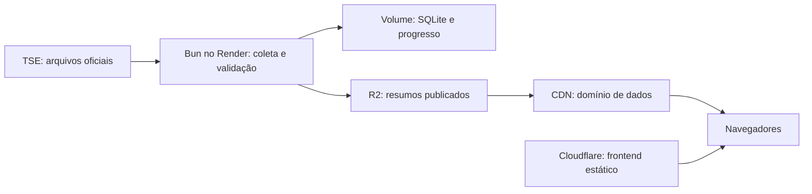

# Plano de coleta e distribuição dos resultados eleitorais

Status: coletor Bun/SQLite e publicação opcional no R2 implementados localmente; ver [operação e testes](../backend/README.md) e [publicação no R2](r2.md). O frontend já consome apenas os resumos preparados pela API. A validação do bucket real e a infraestrutura remota ainda estão pendentes. As seções seguintes descrevem a arquitetura de destino e as etapas para alcançá-la.

## Objetivo

Atender muitos visitantes sem multiplicar as consultas ao TSE. Uma coleta central consulta os resultados, valida os arquivos e publica resumos compartilhados. O público recebe esses resumos pela CDN.

A cobertura implementada inclui Brasil, as 27 UFs e os municípios anunciados, com todos os cargos e turnos em disputa no ciclo. O dimensionamento usa uma fila global, arquivos por cargo/UF, armazenamento comprimido e resumos municipais. Veja [Cobertura nacional](cobertura-nacional.md) para operação e intervalos atuais.

Os 5.568 municípios discutidos são uma referência de cálculo. A cobertura real deve vir da configuração da eleição no TSE e da correspondência com a malha IBGE. DF, exterior e outras abrangências precisam de tratamento explícito, sem forçar todos os registros ao modelo municipal.

## Situação atual

O frontend estático fica em `frontend/` e consulta somente a API de dados. O coletor, o parser [tse.mjs](../backend/tse.mjs), a paleta e as regras eleitorais ficam em `backend/`. O build reúne somente arquivos do frontend em `dist/frontend/`; não existe pasta de código compartilhado entre cliente e servidor.

A coleta central tem limites, persistência e espera após falhas. No navegador, o cliente de API recebe resumos por abrangência, reutiliza as versões e preserva a última leitura quando há falhas. Não consulta configurações, resultados ou fotos diretamente do TSE.

A integração atual está descrita no [README](../README.md). Este plano mantém essa descrição como comportamento atual até a implementação da nova arquitetura.

## Arquitetura escolhida



| Componente | Responsabilidade |
| --- | --- |
| Bun no Render | Descobrir configurações, consultar o TSE, validar e publicar resultados |
| Volume Render com SQLite | Guardar estado da fila, última leitura válida, hashes e progresso |
| R2 Standard | Armazenar os arquivos públicos e versões recentes |
| CDN com domínio próprio | Distribuir JSONs com cache compartilhado |
| Cloudflare Pages ou Workers Static Assets | Hospedar HTML, CSS, JavaScript e mapas |

Usar apenas uma das opções de hospedagem do frontend; escolher na etapa de implantação. Não é necessário converter o site para um framework.

Começar com uma instância do coletor. Redis, Postgres e WebSocket não são necessários nesta versão. A API pública lê os resultados persistidos e usa o mesmo contrato dos arquivos publicados no R2. Durante deploys, impedir dois coletores simultâneos por meio de coordenação de execução; configurar uma réplica, sozinho, não substitui esse cuidado.

## Coleta e orçamento de consultas

Descobrir a eleição pela configuração oficial, sem fixar códigos de eleição ou gerar URLs municipais por tentativa. Preservar a correspondência IBGE/TSE e os zeros à esquerda dos códigos TSE.

Uma fila central deve controlar tanto concorrência quanto requisições por segundo. Limitar conexões simultâneas não garante, sozinho, respeito ao limite por segundo. O orçamento inclui configurações, Brasil, UFs, municípios e novas tentativas.

O TSE informa máximo de 100 requisições por IP por segundo, com possibilidade de bloqueio por dez minutos. Novas tentativas antes do fim podem reiniciar o bloqueio. Muitos erros 404 também podem provocar bloqueio. Essa regra deve ser reconferida antes de cada operação eleitoral.

Como configuração inicial para medir, usar teto de 40–50 requisições por segundo, espaçadas, com concorrência ajustada à latência observada. Não distribuir requisições entre IPs para contornar limites. Confirmar também as características de saída de rede do Render antes da operação.

| Prioridade | Proposta inicial, sujeita a medição |
| --- | --- |
| Brasil e UFs | Buscar a cada 10–15 segundos, dentro do orçamento global |
| Municípios | Varredura contínua com meta inicial de 2–5 minutos por ciclo |
| Resultados completos | Consultar com menor frequência, sem parar definitivamente |
| Configurações | Reutilizar e revalidar periodicamente; atualizar quando houver indisponibilidade de eleição/turno |

Para 5.568 arquivos municipais, um cargo e um turno:

| Ciclo desejado | Consultas médias, apenas municípios |
| --- | --- |
| 10 segundos | 556,8 por segundo |
| 60 segundos | 92,8 por segundo |
| 120 segundos | 46,4 por segundo |
| 180 segundos | 30,9 por segundo |

São cálculos teóricos, sem latência, falhas e outras abrangências. O intervalo nacional real será medido. Priorizar regiões não pode deixar municípios menores sem atualização; ordenar também pelo tempo desde a última consulta.

Uma etapa posterior pode receber interesse temporário por cidades e acelerar sua coleta. Esse endpoint deve validar identificadores, limitar pedidos, expirar prioridades e agrupar solicitações da mesma cidade. Não entra como dependência do primeiro ciclo nacional.

Antes de ampliar a coleta, investigar na documentação oficial se arquivos agregados ou indicadores de alteração permitem reduzir as consultas. Não presumir que esses mecanismos existem ou dispensam a leitura dos resultados.

## Processamento e integridade

Processar respostas aos poucos, com timeout e tamanho máximo, sem manter todos os JSONs brutos na memória. Persistir resumos no SQLite e gerar arquivos de publicação por UF.

Antes de aceitar um arquivo, validar eleição, turno, ambiente, cargo, abrangência e valores numéricos. Reaproveitar as regras existentes após separar dependências do navegador. Divergências devem preservar o resultado anterior e gerar diagnóstico.

Manter isolados ambiente oficial, simulado, eleição, cargo e turno em banco, URLs e caches. Nunca usar votos de outro turno como substituto. Não colocar resultados fictícios nos arquivos oficiais.

O resultado nacional vem da abrangência nacional do TSE. Não somar municípios coletados em momentos diferentes para apresentar um total como oficial. Liderança local não significa candidato eleito nacionalmente. Não presumir que votos nunca diminuem: correções oficiais podem ocorrer.

## Contrato dos dados públicos

Definir um contrato versionado antes de integrar o frontend. Cada resultado deve informar:

- Versão do schema, ambiente, ciclo, eleição, turno, cargo e abrangência.
- Identificadores oficiais e correspondência IBGE quando aplicável.
- Votos por candidatura, percentuais com denominador documentado e seções totalizadas.
- Situação da apuração e tratamento de empate/ausência de votos.
- Horário de geração informado pelo TSE, última consulta bem-sucedida e publicação.
- Estado de disponibilidade e erro conhecido, sem transformar falha em zero votos.

Padronizar horários próprios em UTC e registrar como interpretar o horário fornecido pela fonte. Traduzir para horário de Brasília na interface. Uma consulta recente não significa que o TSE publicou dados recentes.

Exemplo conceitual de organização, ainda sem compromisso de API:

```text
oficial/<ciclo>/<eleicao>/<turno>/<cargo>/
  manifesto.json
  brasil/<versao>.json
  estados/sp/<versao>.json
  estados/rj/<versao>.json
  ...
```

O resumo nacional inclui Brasil e UFs. Cada arquivo estadual contém os resultados municipais necessários ao mapa e ao cartão da cidade. Começar com esses arquivos agrupados; adicionar detalhes municipais separados somente se tamanho ou necessidades da interface justificarem.

## Publicação e cache

1. Comparar os dados normalizados com a última versão para identificar alterações de conteúdo.
2. Gerar e enviar apenas os arquivos alterados, com nomes imutáveis por versão ou hash.
3. Depois de confirmar os uploads, publicar o manifesto apontando para as versões disponíveis.
4. Manter versões anteriores por uma janela de recuperação; remover versões vencidas com retenção controlada.

O manifesto é o ponto de entrada: uma falha durante uploads não deve apontar o público para arquivos incompletos. Ele pode referenciar versões diferentes por UF, com seus horários explícitos; isso não representa uma fotografia simultânea do país.

Evitar reescrever todos os arquivos por causa de um horário de consulta. Separar informação operacional/heartbeat da versão do conteúdo. Definir essa separação no contrato para que a interface também consiga indicar falhas e a saúde da coleta.

| Recurso | Política proposta |
| --- | --- |
| HTML | Revalidar para descobrir novos deploys |
| Assets com versão/hash | Cache longo e imutável |
| Manifesto | Cache compartilhado curto, inicialmente 5–10 segundos |
| Resultados em URLs imutáveis | Cache longo; a troca de versão vem pelo manifesto |
| Diagnóstico público mínimo, se necessário | Cache curto, sem segredos nem logs internos |

Configurar explicitamente cache para JSON no domínio próprio ligado ao R2. O endereço de desenvolvimento `r2.dev` não é a opção de produção para essa distribuição. Configurar CORS para a origem do frontend, tipo de conteúdo e compressão negociada; verificar os cabeçalhos reais após implantação.

O navegador consulta o manifesto periodicamente, inicialmente a cada 10–15 segundos com pequena variação aleatória, e baixa apenas a abrangência aberta quando sua versão muda. Pausar consultas em abas ocultas. Não acrescentar parâmetros aleatórios às URLs que eliminem o reaproveitamento do cache.

O atraso percebido combina publicação do TSE, espera na fila, processamento, cache do manifesto e próxima consulta do navegador. Nenhum intervalo isolado garante atualização instantânea.

## Falhas e recuperação

- Rede, timeout e 5xx: espera progressiva com variação aleatória; preservar dados anteriores.
- 404: verificar configuração e disponibilidade; não continuar percorrendo milhares de URLs ausentes.
- 403/429: interromper as consultas daquele coletor e respeitar o maior prazo entre bloqueio conhecido e `Retry-After`; não testar repetidamente durante a pausa.
- Resultado inválido: rejeitar sem substituir o último resultado válido.
- Falha de upload: manter o manifesto anterior e repetir a publicação depois.
- Reinício: recuperar fila e resultados persistidos, sem disparar toda a carga de uma vez.
- Coletor indisponível: a CDN/R2 continuam servindo a última publicação; a interface deve mostrar o atraso pelo horário, mesmo sem receber uma nova marcação de erro.

Definir limites máximos de tolerância para exibir “atualização atrasada”. Dados com apuração completa podem ter política distinta. Ausência, zero votos, dados antigos e falha são estados diferentes.

Prever backup/checkpoint privado do estado necessário à recuperação. Arquivos internos e credenciais não devem ficar no bucket público de resultados.

## Recursos, custos e limites

As informações abaixo foram consultadas durante o planejamento em 24/10/2026. Conferir novamente antes de contratar ou publicar. São referências, não promessa de custo final.

### Render

O backend usa um Web Service com Docker: API HTTP e coletor rodam no mesmo processo Bun. A configuração está em `backend/render.yaml`; o [guia de implantação](render.md) define `backend` como diretório do serviço e SQLite em disco persistente `/data`.

Para operação contínua com este banco, usar serviço pago e uma instância. O Free suspende após 15 minutos sem tráfego de entrada e não oferece disco persistente. Consultas de saída ao TSE não impedem essa suspensão.

O Blueprint parte de 0,5 CPU, 512 MB de memória e 1 GB de disco, sujeitos a medição e ajuste. Conferir no painel os valores de máquina, disco e tráfego antes de contratar; não há estimativa de custo validada para a cobertura nacional. Medir memória residente, CPU, volume, rede e idade dos resultados em operação real. Fora da apuração, reduzir a frequência ou parar por programação explícita.

### R2 Standard e CDN

A franquia consultada inclui 10 GB-mês de armazenamento, 1 milhão de operações Classe A e 10 milhões Classe B por mês. Saída de dados do R2 não tem cobrança de egress. A franquia não significa quantidade ilimitada de operações e não se aplica ao armazenamento Infrequent Access.

Exemplo de seis horas publicando a cada 30 segundos, supondo alteração em todos os arquivos:

| Formato | Escritas estimadas |
| --- | --- |
| 5.568 arquivos municipais por publicação | 4.008.960 |
| 27 arquivos estaduais por publicação | 19.440 |

O exemplo exclui manifesto, Brasil, detalhes e outras operações. Agrupar e publicar somente mudanças reduz operações; medir o tamanho dos arquivos para equilibrar escrita, transferência e download no celular. Não manter uma cópia histórica completa a cada intervalo sem calcular retenção.

Cache hits na CDN evitam leituras no armazenamento, mas expiração e distribuição geográfica dos visitantes afetam as leituras reais. Não calcular custo assumindo que cada visitante é um acesso ao R2 ou que todos os acessos serão cache hits.

### Frontend

Pages ou Workers Static Assets atendem ao frontend estático existente. Workers Static Assets oferece requisições estáticas gratuitas e ilimitadas; execução de código Worker tem limites e cobrança próprios. As consultas aos resultados no R2 continuam seguindo as regras do R2.

## Configuração e observabilidade

Na implementação, criar exemplo seguro de configuração com placeholders para ambiente da fonte, ciclo/turno/cargo, limite de consultas, concorrência, timeouts, intervalos, caminho do SQLite, bucket, endpoint R2 e origem pública de dados.

Guardar credenciais de escrita do R2 somente nas variáveis secretas do Render, com permissão limitada ao bucket necessário. O frontend recebe apenas URLs públicas. Não criar um proxy que aceite URLs arbitrárias do visitante.

Registrar e acompanhar:

- Tempo de uma varredura e idade dos dados por território, incluindo os mais atrasados.
- Quantidade de municípios configurados, mapeados, consultados, disponíveis e com erro.
- Consultas por segundo, latência, timeouts, 404, 403 e 429.
- Última coleta/publicação bem-sucedida e reinícios do processo.
- Memória, CPU, tamanho do volume, saída de rede e operações no R2.
- Tamanho dos arquivos, download no celular e taxa de acerto do cache.

Alertas devem destacar coleta parada, cobertura incompleta, bloqueio e aproximação dos limites de recursos/créditos. A saúde do processo não substitui a medição da atualização dos dados.

## Etapas para iniciar

### 1. Definir contrato e coletar uma UF

- Extrair/reutilizar validações existentes em módulo compatível com Bun.
- Definir schema, estados de disponibilidade e regras dos timestamps.
- Implementar fila limitada, persistência e coleta de Brasil, uma UF e seus municípios.
- Verificar correspondência IBGE/TSE e casos de apuração completa, empate e ausência.

### 2. Medir cobertura nacional

- Executar varredura controlada respeitando a fonte e seu ambiente disponível.
- Medir duração, cobertura, memória, tamanho em disco e consumo de rede.
- Definir intervalos possíveis com margem para falhas e outras abrangências.
- Validar retomada após reinício e isolamento entre turnos/ambientes.

### 3. Publicar no R2

- Configurar domínio de dados, cache para JSON e CORS.
- Implementar publicação por mudança, manifesto e retenção.
- Verificar consistência durante falha de upload e validade das versões anteriores.
- Medir custos/operações com os arquivos e intervalos reais.

### 4. Conectar mapa e corrida

- Adaptar os consumidores ao mesmo contrato e origem de dados.
- Manter carregamento geográfico independente da coleta eleitoral.
- Exibir geração da fonte, atraso e indisponibilidade corretamente.
- Verificar que não restam consultas diretas de resultados ao TSE nas telas migradas; decidir separadamente fotos e simulação.
- Hospedar frontend na opção Cloudflare escolhida e verificar links compartilhados.

### 5. Ensaiar e operar

- Simular público contra nossa infraestrutura, sem multiplicar carga no TSE.
- Testar cache, falhas de rede, bloqueio, reinício e recuperação do manifesto.
- Configurar orçamento, alertas e procedimento de reinício/retorno à última versão válida.
- Ensaiar no ambiente de simulado quando disponível, mantendo a identificação visível.
- Confirmar configurações oficiais e fontes antes da operação eleitoral.

## Critérios para a primeira versão estar pronta

- Cobertura reconciliada com a configuração oficial, com exceções documentadas.
- Nenhuma mistura de ambiente, cargo, eleição ou turno.
- Fila respeita orçamento global inclusive em falhas e reinícios.
- Atraso nacional medido e apresentado sem promessa de atualização instantânea.
- Visitantes compartilham arquivos/cache e não provocam coleta individual.
- Última publicação continua acessível quando o coletor para.
- Recuperação testada e consumo compatível com o orçamento escolhido.

Os testes estão divididos entre `test/frontend/` e `test/backend/`, com execução documentada no [README](../README.md). Cobrir validação da fonte, limites com relógio controlado, recuperação e consistência da publicação; usar respostas locais para carga e falhas.

## Decisões ainda a fechar após as medições

- Pages ou Workers Static Assets para o frontend.
- Plano/orçamento Render e janela de operação contínua.
- Intervalo nacional possível e quantidade de consultas simultâneas.
- Tamanho dos resumos e necessidade de detalhes municipais separados.
- Janela de retenção de versões e frequência de backup do estado.
- Necessidade de priorização por interesse dos visitantes.

## Referências

- [Informações técnicas de divulgação do TSE](https://www.tse.jus.br/eleicoes/informacoes-tecnicas-sobre-a-divulgacao-de-resultados)
- [Docker no Render](https://render.com/docs/docker)
- [Discos persistentes no Render](https://render.com/docs/disks)
- [Limites do Render Free](https://render.com/docs/free)
- [Blueprint do Render](https://render.com/docs/blueprint-spec)
- [Preços e franquia do R2](https://developers.cloudflare.com/r2/pricing/)
- [Bucket público, domínio próprio e cache do R2](https://developers.cloudflare.com/r2/buckets/public-buckets/)
- [Cobrança de Workers Static Assets](https://developers.cloudflare.com/workers/static-assets/billing-and-limitations/)
